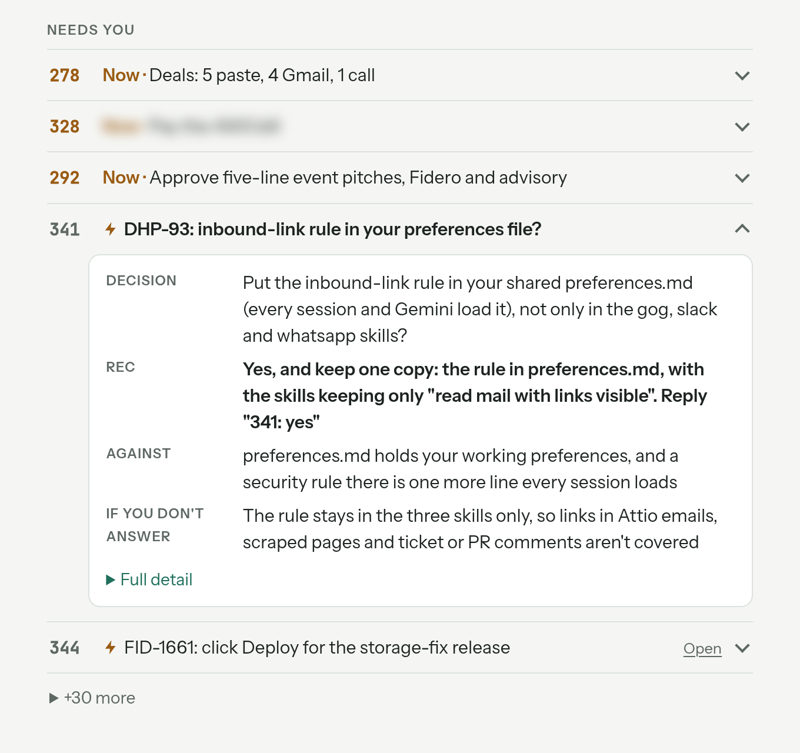

import AgentTeam from "@/components/diagrams/AgentTeam.astro";

Most of the day-to-day calls in my company are now made by AI agents. They plan the work, build it, release it and draft every follow-up to prospects and customers. What still needs me arrives as one ranked list on my phone, twice a day.

It took a few weeks of things going wrong to get here. A month ago four PM agents and several of their workers could each ping my phone whenever they liked, and nothing showed me in one place what was waiting on me. A week ago the last role filled in when a deals agent went live. So here's the whole setup: what each agent decides alone, what still reaches me and what broke on the way.

## The team

<AgentTeam>
  Who reports to whom. Everything below me runs on one server.
</AgentTeam>

I'm at the top and Clara, the chief of staff, sits below me. Below her are four PMs (one for each area of the business) plus Sam, who handles deals. Each PM starts a separate worker for each piece of work (ticket). The worker reports back to the PM and never to me.

All four PMs are called Ben because they're one agent definition run four times, with a different brief for each area. It makes the org chart look odd. But a fix to how one PM works reaches all four.

Each agent is a long-running Claude Code session with a name, a written definition and its own memory. They all live on [one always-on Linux box](/posts/running-ai-agents-on-a-30-euro-linux-box) and restart with a fresh context every morning at 8. Anything they need to carry over lives in tickets, notes and the queue of what's waiting on me rather than in a conversation.

## One-way and two-way doors

My agents split their decisions into two kinds. A two-way door is a call you can walk back through: if it turns out to be wrong you can undo it completely, by rolling back the code, reopening the ticket or editing the doc. A one-way door is a call you can't fully undo. Agents make two-way calls themselves and one-way calls come to me. Examples are spending we haven't budgeted for, pricing, contracts and anything that reaches a customer.

I heard the idea years ago from someone describing how they ran their company. They meant people rather than agents, but it stuck with me and it works just as well for agents.

There's a catch I didn't see at first. You only walk back through a two-way door once someone notices the call was wrong. A bad call that breaks a test gets noticed in minutes. A bad call that cuts something from a plan might never get noticed, because nothing breaks and no one goes looking. So the rule has a second half. When a call could go either way the agent takes the faster route. If a mistake wouldn't show itself, it takes the safer one instead.

Every call an agent makes gets logged as a comment on the ticket it affects. The comment says what it decided, what it rejected, why and how to reverse it. I don't read them, they're just there in case something goes wrong and I need to work out why.

## Who decides what

| Agent                        | Decides alone                                                                                                                                            | Comes back to me                                                                                                             |
| ---------------------------- | -------------------------------------------------------------------------------------------------------------------------------------------------------- | ---------------------------------------------------------------------------------------------------------------------------- |
| **Clara** (chief of staff)   | Questions my past decisions already answer, and clashes between PMs over what goes first                                                                 | Everything else that needs me, ranked in one queue                                                                           |
| **Ben** (PM, one per area)   | What to work on next from the week's priorities, the answers to planning questions, starting and stopping workers, and merging code once its checks pass | Anything a customer or buyer will see, tickets I want to shape myself and new work outside the week's priorities (via Clara) |
| **Sam** (deals)              | Which follow-up is owed and when, the order of the day's drafts, chase dates, when to park an account and the wording of each draft                      | Every message, since I send them all myself, and any price or term I haven't already set (via Clara)                         |
| **Workers** (one per ticket) | How to do their one ticket                                                                                                                               | Nothing. They report to their PM                                                                                             |

The priorities are mine. Each week I set what every PM works on. A PM that wants to add something raises it with Clara instead of starting it.

## What reaches me

Everything that needs me goes to Clara and she keeps it as one ranked queue on a page I open on my phone or laptop. Each item has a number that never changes, a one-line question and her recommendation. It also has the strongest case against her recommendation and what happens if I don't answer. I reply in her session, usually by number ("12 yes, 14 B"), and she passes my answer down the chain to whichever agent asked.

_The queue as it stood today, with one row opened and one blurred._

She notifies me twice a day at 11am and 4pm with the top five items. Something that blocks work today can interrupt in between and nothing else. The PMs and Sam don't have phone notifications switched on at all.

I take Clara's recommendation as written about 75% of the time, change it about 20% of the time and say no to the rest. So my part is usually reading a card and agreeing, which takes seconds. The card follows the same idea as [my agents' reply style](/posts/be-concise-is-the-wrong-instruction): lead with the decision and hold the rest back.

## What it took

None of this worked first time. Three things from the first few weeks shaped how it runs now.

**Day one was relentless.** On Clara's first full day about 30 things reached me. Each one was pushed to my phone within the hour and anything she cleared vanished from the page. By the evening I couldn't tell what had been done. That's where the two set times a day came from, along with a list of what got cleared that day.

**An old bug became an emergency.** A PM found a bug that had probably been there for over a year. The PM spent the day fixing it and Clara passed it to me as urgent. It wasn't the week's priority and it pulled me off what was. Now it's my call whether something long-standing is urgent, so the PM raises it and waits.

**Sam's drafts still need me.** I've sent 53 of Sam's drafts since it went live and I edited 42 of them. That's why Sam still only drafts. It compares each draft with what I actually sent, and an edit it sees twice becomes a rule in its writing guide.

One habit worth copying: before each agent went live, a separate agent that hadn't built it read its instructions and listed what would go wrong. Every problem it found was fixed before launch.

## The bottleneck is now me

The agents get through their work faster than I get through the queue. Items waiting on me piled up initially because my time went into adjusting the system rather than answering them. That work is settling now, so I should be able to clear down the open items quickly from here.

What's left for me is the bit I'd want to keep anyway: setting the priorities each week, making the one-way calls and looking at anything before a customer sees it.
